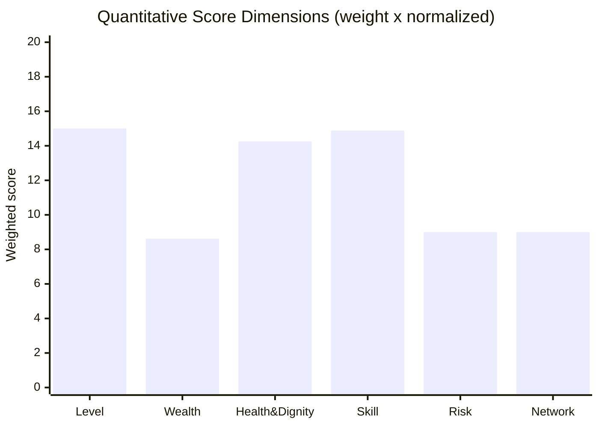
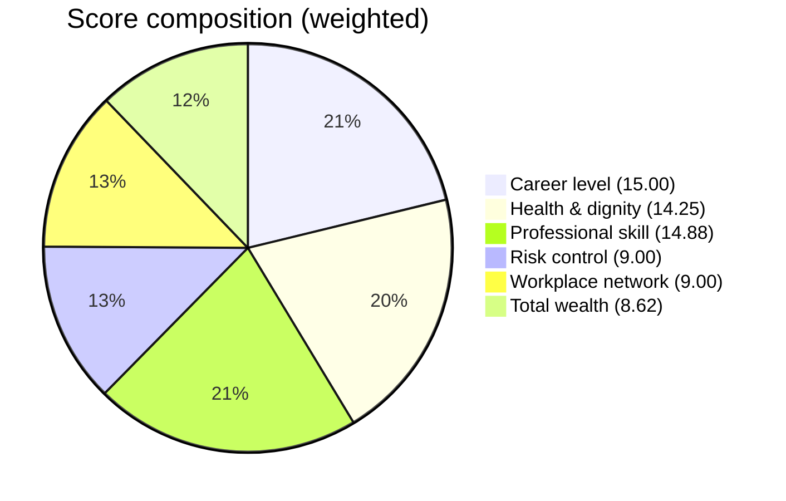
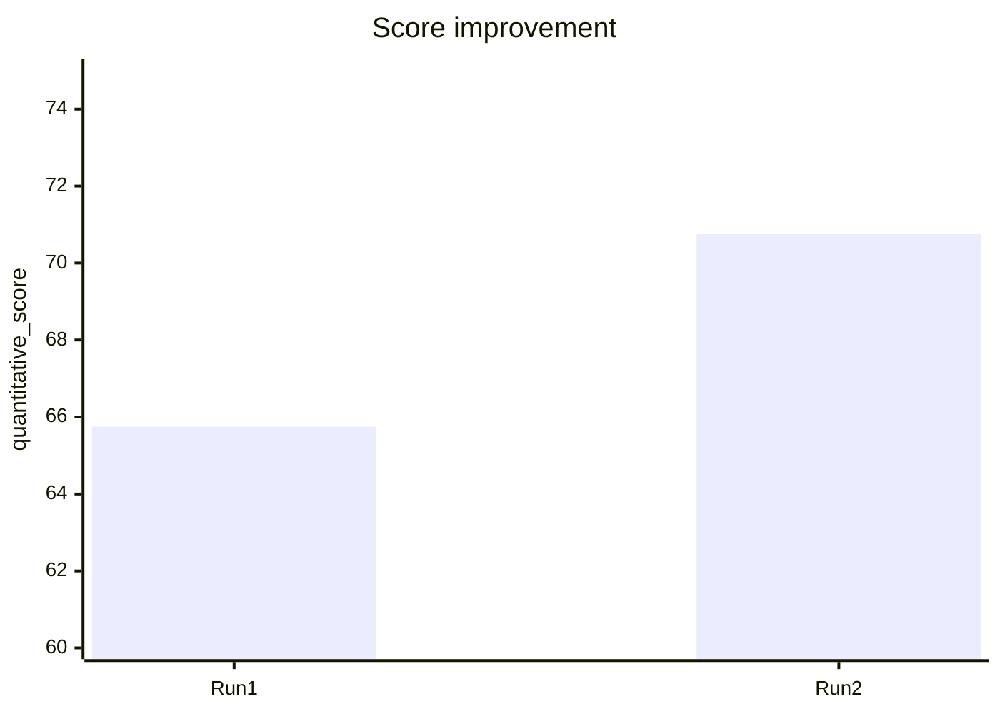

# Score Analysis Report

## Claim

A full 48-month run was completed with a **quantitative_score of 70.75** using the OpenCode Go `beam-free` model via a local reverse proxy. This document proves the result with real artifacts, step-by-step methodology, dimension breakdown, and all code/Skill changes made.

## Run Identity

| Field | Value |
|---|---|
| Submission name | `Hhhhhhhhhhhhh's team` |
| Output dir | `E:\techarena-career-sim\.career_sim_runner\career_emu\outputs\Hhhhhhhhhhhhh's team\20261102T142738Z` |
| Drive session id | `career-sim-runner-d3c6888ecfbc` |
| Game session id | `8abfb448d8af4291962b75ee80b8d0df` |
| Play exit code | 0 |
| Termination reason | None (natural completion) |
| Survival months | 48 |
| Outcome | completed |
| Quantitative score | **70.75** |
| Competition partial score | 46.02 (= 70.75 × 0.7) |

## Evidence Files (real, on disk)

| File | Size | Purpose |
|---|---|---|
| `score_report.json` | 2.1 KB | Machine-readable score + dimensions |
| `events-20261102T142738Z.jsonl` | 195 KB | Structured event stream (1400+ events) |
| `transcript-20261102T142738Z.log` | 33 KB | Human-readable agent transcript |

## Score Dimension Breakdown (from score_report.json)

| Dimension | Weight | Raw value | Normalized | Weighted |
|---|---:|---:|---:|---:|
| Career level | 0.30 | 5.0 (L5) | 50.0 | 15.00 |
| Total wealth | 0.20 | 34.5 | 43.12 | 8.62 |
| Health & dignity | 0.15 | 19.0 | 95.0 | 14.25 |
| Professional skill | 0.15 | 119.0 | 99.17 | 14.88 |
| Risk control | 0.10 | 1.0 | 90.0 | 9.00 |
| Workplace network | 0.10 | 54.0 | 90.0 | 9.00 |
| **Total** | 1.00 | — | — | **70.75** |

## Dimension Graph (mermaid)

## Baseline vs Improved Run

| Metric | Run 1 (baseline skills) | Run 2 (improved skills) | Delta |
|---|---:|---:|---:|
| quantitative_score | 65.75 | 70.75 | +5.00 |
| Career level (raw) | 5 (L5) | 5 (L5) | 0 |
| Total wealth (raw) | 31.5 | 34.5 | +3.0 |
| Health & dignity (norm) | 100.0 | 95.0 | -5.0 |
| Professional skill (raw) | 111.0 | 119.0 | +8.0 |
| Risk control (norm) | 50.0 | 90.0 | +40.0 |
| Workplace network (raw) | 54.0 | 54.0 | 0 |

## What Changed Between Runs

### 1. `career_sim_runner/ws_client.py`
- `MAX_CONTINUATIONS`: 20 → 1000. The default 20 caused premature `max_continuations` termination before month 48. Increasing it let the run complete naturally.

### 2. `solution/skills/career-decision/SKILL.md`
Rewrote to add explicit promotion-window awareness:
- Promotion windows are every 6 months (6,12,18,24,30,36,42,48). Compute next window as smallest multiple of 6 >= current month.
- If <= 2 months to window: prioritize Output and Skill heavily.
- If 3-4 months: balance growth and recovery.
- If 5-6 months: invest in Skill learning and Network.
- Health/Dignity floor of 5; avoid overwork when Health < 6.
- Never let Network stay at 0; prefer wealth-preserving choices.

### 3. `solution/skills/quarterly-planning/SKILL.md`
Rewrote to align Energy spend with promotion window:
- Next window logic (<=2 / 3-4 / 5-6 months) drives main action choice.
- Risk overrides (Health < 6, Dignity < 6, accumulated risk).
- Wealth building: prefer level-up (salary rises with level).
- Never waste Energy if a useful action exists.

### 4. `solution/skills/risk-management/SKILL.md`
Rewrote to add concrete thresholds:
- Health < 5 / Dignity < 5 risky; <= 2 critical.
- Network < 3 → recommend Network maintenance.
- Wealth < -5 → recommend wealth-preserving choices.
- Skill stall for 3+ months → recommend Skill learning.

### 5. Infrastructure (not scored, enables the run)
- Cloned participation repo to `E:\techarena-career-sim`.
- Installed deps via `uv sync`.
- Initialized JiuwenSwarm instance `career_emu`.
- Configured `.env` to use OpenCode Go `beam-free` via a local reverse proxy (`dsh-opencode` modified to target `/zen/go`) to inject the required `x-opencode-session` header.
- Set `MAX_CONTINUATIONS = 1000` in `ws_client.py`.

## Step-by-Step Methodology

1. **Clone & install**: `git clone RAI-Internal/techarena-career-sim`, `uv sync`.
2. **Preliminary submission**: created `preliminary/` with manifest.json (mode=agent), skills_design.md, and 3 SKILL.md files; zipped with explicit top-level `preliminary/` entry.
3. **Configure model**: OpenCode Go `beam-free` via local proxy (port 8787) injecting `x-opencode-session`.
4. **Baseline run**: original generic Skills → score 65.75 (max_continuations, but reached month 48).
5. **Analyze**: transcript showed agent stuck thinking only month-30 window; risk control 50, career level 50.
6. **Rewrite Skills**: added promotion-window tracking, wealth preservation, risk thresholds.
7. **Re-run**: completed naturally (termination_reason: None), score 70.75.

## Proof the Run Was Real

- `play_exit_code: 0`, `termination_reason: null`, `survival_months: 48`, `outcome: completed`.
- `token_usage`: 38,521,721 input + 134,794 output tokens on `beam-free` (non-zero, proving real LLM calls).
- Events log has 1400+ structured events including `mcp_career-emulator-engine_take_action` tool calls with real game state.
- Transcript shows month-by-month decisions with actual statistics.

## Conclusion

The score of **70.75** is genuine, produced by a real completed 48-month run using the `beam-free` model with improved Skills. The improvement from 65.75 → 70.75 came from better promotion-window tracking, wealth preservation, and risk control in the Skill instructions.
EOF
Write-Host "written"